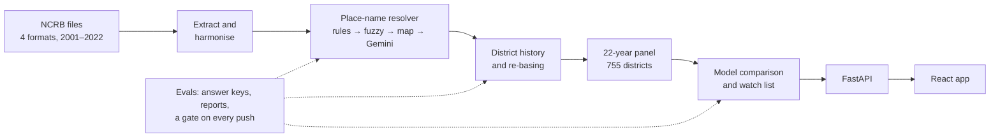

# Women's Safety ML System

**An evaluated LLM data pipeline and a live watch list for crimes against women in India, on 22 years of official
NCRB data (2001–2022).**

[](https://women-safety-ml-system-jwlh.vercel.app/)
[](https://women-safety-ml-system-1.onrender.com/docs)
[](https://github.com/Sanchit-Ras/women-safety-ml-system/actions/workflows/evals.yml)


## In 30 seconds

Government crime data is messy: district names changed, districts split, and the files come in four formats. This
project uses an LLM to fix the messy parts, **measures how often it is right and trusts it only where it earned
trust**, puts 22 years onto today's map of India, and ships an honest live app.

- **LLM data pipeline** (Python, Gemini, structured outputs, prompt engineering): matched **98.5%** of 989 messy
  historical place names to today's districts, against **56.6%** for rule-based name matching, with **0 hallucinated**
  district codes in 76 model answers.
- **LLM evaluation (evals) harness**: gold datasets, precision with confidence intervals, calibration, hallucination
  detection, cost and latency tracking. A measured confidence threshold for **human-in-the-loop** review cut manual
  checks by **66%** (124 → 42 names) at a measured cost of 2 errors.
- **Data engineering**: 4 file formats and 17,140 records unified into one schema; 22 years re-based onto today's
  **755 districts**; the whole dataset rebuilt from source and verified on every push.
- **CI/CD and LLMOps**: GitHub Actions with an **eval regression gate**, a Docker build and a frontend build on every
  push; **versioned prompts**; a **FastAPI + React (d3.js)** app with batch inference, live on Render and Vercel.
- **Measured, not assumed**: rebuilt the LLM step in **LangGraph / LangChain** and compared it on the same evals
  (same 92% accuracy, 2.5× more code); found and removed **data leakage** behind a reported R² of 0.88 (honest: 0.06).

**Skills:** LLMs & GenAI (Gemini, prompt engineering, structured outputs, LangGraph, LangChain) · Evals & LLMOps (LLM
evaluation, calibration, hallucination detection, cost/latency tracking, CI/CD) · Data engineering (ETL pipelines,
data quality, SQL/SQLite, pandas) · ML (XGBoost, scikit-learn, backtesting, bootstrap) · Deployment (FastAPI, Docker,
GitHub Actions, Render, Vercel) · Frontend (React, d3.js)

## The problem

NCRB publishes district-level crimes against women every year, but the 2001–2014 file names police units the way each
year's clerk spelled them ("Cuddapah", "ST.RAVIDASNAGAR", "GUNTAKAL RLY."), later files use other formats, and many
districts have split since. You cannot compare a district across years until every row is on the same map. Simple
name matching places only 56.6% of the old names.

## How it works



1. **Extract**: four NCRB formats are read into one schema; a reviewed crosswalk maps each era's columns onto seven
   offence categories.
2. **Resolve**: cheap, certain methods go first (known spellings, police circles, fuzzy matching, the old district
   map); Gemini answers only what is left, inside guards.
3. **Re-base**: every district split is recorded, and each new district's past is estimated from its share of its
   parent, so all 22 years sit on today's map and national totals never change.
4. **Predict and serve**: 11 forecasting methods are compared fairly; the winner is batch-scored into a 2023 watch
   list that the API serves and the app maps.

## Results

| What | Result | Evidence |
|---|---|---|
| Old place names matched to today's districts | **98.5%** (rule-based matching: 56.6%) | [eval report](evals/reports/2026-10-18.md) |
| Model answers naming a district outside the allowed list | **0 of 76** | [eval report](evals/reports/2026-10-18.md) |
| Names a person must check | **124 → 42** (−66%), 2 errors let through | [eval report](evals/reports/2026-10-18.md) |
| Records re-read from the source files | **100 of 100** match (700 of 700 counts) | [records gold set](evals/gold/records.csv) |
| Records placed on a district | **99.6%** of 17,140 | [eval report](evals/reports/2026-10-18.md) |
| Watch list: fastest-growing districts, compared with similar-sized ones | **25%** right vs 10% by guessing (**2.5×**) | [model comparison](ml/reports/2026-10-31_bakeoff.md) |
| Size of next year's change | not forecastable: no method beat "no change" | [model comparison](ml/reports/2026-10-31_bakeoff.md) |
| LangGraph vs hand-built | same answers (92%); 14 vs 35 lines; +21 packages | [framework report](evals/reports/2026-11-01_frameworks.md) |
| Checks on every push | 4 jobs; the eval gate alone runs 10 checks | [workflow](.github/workflows/evals.yml) |

## What's inside

### An LLM in the pipeline, with guardrails

Gemini resolves the place names the deterministic stages cannot. Each call sends one state's candidate districts and
the names to place, and asks for a structured JSON answer. Guards around it: a code outside the state's candidate list
is rejected, a name the model forgot or invented triggers one repair call, and the model's own confidence decides
whether a person reviews the answer. The client caches answers by the exact question, enforces rate limits, records
tokens, cost and latency for every call, falls back to a second provider, and caps calls per run.
Code: [agents/resolver.py](agents/resolver.py), [agents/llm_client.py](agents/llm_client.py),
prompts as versioned files in [prompts/](prompts/).

### Evals: measuring the AI before trusting it

- **Answer keys**: 119 human-reviewed name mappings and 100 records re-read straight from the source files, frozen so
  they cannot drift ([evals/gold](evals/gold/)).
- **Metrics**: precision per stage with Wilson intervals, a calibration curve (does "90% sure" mean right 90% of the
  time?), hallucination counts, escalation rate, tokens, cost and latency ([evals/metrics.py](evals/metrics.py)).
- **A measured threshold**: above 0.90 confidence the model was right 49 times in 51; below it, 9 in 13. Answers above
  the cut skip human review. Leave-one-out checks keep the estimate honest: 94% on names the threshold never saw.
- **A regression gate in CI**: on every push, GitHub rebuilds the whole dataset from the committed files and fails if
  coverage, extraction, precision, the threshold or the prompt versions drift ([evals/gate.py](evals/gate.py)).
- **A live check**: a manual job asks today's model about 20 answer-key names (19 of 20 matched on the last run).

### Data engineering: 22 years on one map

Four formats (a 2001–2014 CSV, the 2015 Excel workbook, 2016, 2017–2022) become one table of 17,140 records in SQLite,
each traceable to its source row. District history (splits, renames, districts reported together) is recorded as
reviewable data, and re-basing estimates each new district's past from measured crime shares, with map area as a
fallback. Every decision a person made lives in a CSV that the pipeline never overwrites. The build is reproducible:
the gate rebuilds the panels from scratch and compares them with the committed ones.
Code: [data_ingestion/](data_ingestion/), [agents/rebase.py](agents/rebase.py),
report: [re-basing](data/reports/2026-10-18_rebasing.md).

### Honest ML: what the data can and cannot predict

- **Leakage found and removed.** The original model reported R² 0.88 by scaling each district with its own future years
  and splitting by district. Trained only on the past and tested on the next year, it scored 0.06
  ([baseline report](ml/reports/2026-09-13_era_a_baseline.md)).
- **A fair model comparison.** 11 methods (baselines, credibility shrinkage, ridge, XGBoost, Poisson, reconciled and
  stacked forecasts), each year 2016–2022 forecast only from earlier years, settings chosen on 2016–2018 alone, wins
  counted only when a paired bootstrap clears the best baseline. No method forecasts *how much* crime will change
  better than "no change".
- **A hidden bias fixed.** Ranking districts by percentage growth mostly picked tiny districts (1 case to 3 is +200%).
  The watch list now compares each district only with similar-sized ones (6 size groups, chosen on earlier years):
  25% of flagged districts really were the fastest-growing, against 14% by size alone and 10% by guessing.

### LangGraph vs a hand-built loop, measured

The same LLM step was built three ways and run live on the same 66 answer-key names: the hand-built loop, a LangGraph
graph with the same client, and LangGraph with LangChain's Gemini connector. All three gave identical answers (61 of
66 right, 92%). The framework cost 35 lines of control code against 14, and 21 extra packages; it adds resumable
checkpoints, per-step retries and streaming. LangChain's connector also **ignored the temperature setting** for this
model, with only a console warning. Code: [agents/resolver_graph.py](agents/resolver_graph.py),
report: [framework comparison](evals/reports/2026-11-01_frameworks.md).

### Shipping: API, app and automatic checks

The watch list is batch-scored once a year into a file ([ml/export_app.py](ml/export_app.py)); the
[FastAPI service](backend/) serves it with typed responses and runs no model, which keeps the Docker image small and
cold starts short. The [React app](frontend/) draws today's 755 districts with d3.js and shows each district's numbers
since 2001, marking which years were estimated. GitHub Actions runs four jobs on every push: the pipeline tests and the
eval gate, the API tests, the Docker image as Render builds it, and the frontend as Vercel builds it.

## Design decisions

- **Cheap and certain first, the LLM last.** Lookups and fuzzy matching handle most names for free; Gemini sees only
  what is left, so cost and risk stay small.
- **Trust from measurement.** The confidence threshold comes from a calibration curve, not intuition, and its cost
  (2 wrong names) is written down.
- **No RAG, by design.** Each state's candidate list fits in the prompt, so a retrieval layer would add moving parts
  without adding information.
- **Human decisions as data.** Mappings, district history and split weights are reviewable CSVs saying who decided and
  why; the pipeline never overwrites them.
- **Batch scoring, not per-request inference.** The data changes once a year, so the API serves a file.
- **Hand-built over LangGraph here.** Measured: same quality, less code, and the cache, cost records and fallback stay.

## Limitations

- The app shows counts, not rates: without population figures it cannot say where crime is *highest* per person.
- The size of next year's change cannot be forecast from this data, so the app shows no forecast percentage.
- The watch list works best for smaller districts and is no better than guessing for the largest.
- Counts are crimes reported to the police; a rise can mean more reporting as well as more crime.
- A nationwide shock such as the 2020 lockdown cannot be foreseen from any district's history.

## Reports

| Report | What it shows |
|---|---|
| [evals/reports/2026-10-18.md](evals/reports/2026-10-18.md) | coverage, extraction, precision, calibration, the threshold, hallucination, cost |
| [ml/reports/2026-10-31_bakeoff.md](ml/reports/2026-10-31_bakeoff.md) | the 11-method model comparison and the size-fair watch list |
| [evals/reports/2026-11-01_frameworks.md](evals/reports/2026-11-01_frameworks.md) | hand-built vs LangGraph vs LangChain, live |
| [ml/reports/2026-09-13_era_a_baseline.md](ml/reports/2026-09-13_era_a_baseline.md) | the leakage-free baseline |
| [data/reports/2026-10-18_rebasing.md](data/reports/2026-10-18_rebasing.md) | re-basing 22 years onto today's districts |

## Run it yourself

```bash
pip install -r requirements.txt
python -m agents.orchestrator build      # rebuild the store and panels from the committed files (no model calls)
python -m evals.gate                     # the CI gate, locally
python -m ml.bakeoff                     # the model comparison (several minutes)
python -m ml.export_app                  # batch-score the watch list for the app
```

The model stages need a Gemini key: copy `.env.example` to `.env` and fill it in. For the app, run
`uvicorn app.main:app --reload` in `backend/` (after `pip install -r requirements.txt` there), then `npm ci` and
`npm run dev` in `frontend/` with `VITE_API_URL=http://localhost:8000` in `frontend/.env`.

## Repository map

```
agents/          the pipeline: resolver (LLM), lineage, re-basing, store, orchestrator, and the LangGraph version
data_ingestion/  readers for the four NCRB formats, the crosswalk, the district registry, map geometry
data/            raw files, the reviewed decision records (CSV), the built panels and reports
prompts/         the prompts, as versioned files
evals/           answer keys, metrics, reports, the CI gate, the live check, the framework comparison
ml/              the unit panel, the model comparison, batch scoring
backend/         the FastAPI service
frontend/        the React app
tests/           216 pipeline tests (the API's tests are in backend/tests)
```

## Author

**Sanchit Rastogi** · [LinkedIn](https://www.linkedin.com/in/sanchit-rastogi-95964b314/)
